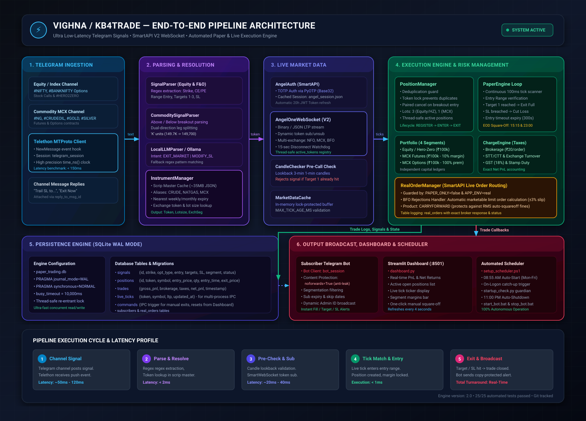

# Vighna (KB4Trade) - Low-Latency Telegram Trading System

A robust, low-latency automated trading engine that listens to Telegram alert channels in real-time, parses options and futures signals, resolves instruments via Angel One SmartAPI, streams live tick data over WebSocket, and executes trades in either a realistic paper trading environment or live through Angel One SmartAPI.



---

## Key Features

- **Multi-Segment Signal Parsing**:
  - **Index & Stock Options**: Formats such as `#NIFTY 23450 PE`, `#BANKNIFTY 50000 CE`, `#TECHM 1580 PE SEP`.
  - **Commodities (MCX)**: Futures and options for Natural Gas, Crude Oil, Gold, Silver (e.g., `#NG FUT Above 289`, `#CRUDEOIL 8500 PE OCT`).
  - **Dual-Direction Signals**: Automatically captures simultaneous long and short breakout levels (Above / Below) and cancels the unentered leg once the first triggers.
  - **Local LLM & Regex Fallback**: Handles conversational reply updates (trailing SL, adjusting targets, market exits, cancellations) using a local LLM or rule-based parser.
- **Instrument Resolution & Aliases**:
  - Automatically fetches and caches Angel One's instrument master (`scrip_master.json`).
  - Matches nearest weekly/monthly expirations and resolves trading symbols and exchange tokens (`NFO`, `MCX`, `BFO`).
  - Maps common abbreviations (e.g., `CRUDE` -> `CRUDEOIL`, `NATGAS` -> `NATURALGAS`).
- **Live Market Data WebSocket (SmartAPI V2)**:
  - Low-latency WebSocket streaming with automated heartbeat, reconnection watchdog, and dynamic resubscription.
  - Target-reached pre-call validation via historical candle lookback to prevent entering stale signals that already hit their target.
- **Paper Trading Engine & Realistic Accounting**:
  - Simulates fills across Equity, Commodity Futures, Commodity Options, and Hero-Zero using one shared `INITIAL_CAPITAL` pool; the configured budget is not multiplied by segment.
  - Stores the exact entry margin per position and commits position, trade, and shared-cash updates atomically. Legacy per-segment balances are migrated from starting capital + recorded net P&L − margin reserved by open positions, rather than summed.
  - Accurate Indian brokerage, STT/CTT, exchange transaction charges, stamp duty, SEBI turnover fees, and GST calculation.
  - Automated End-of-Day (EOD) square-off at 15:15 IST (Equity/NSE/BSE) and 23:00 IST (MCX commodities).
- **Broker Order Integration (`RealOrderManager`)**:
  - The order placement code exists, but the main application intentionally refuses `APP_ENV=real` with `PAPER_ONLY=false` until broker order-fill/status reconciliation is implemented. This prevents local paper-ledger state from being mistaken for a confirmed broker fill.
  - Paper mode is the supported mode for the current validation batches. Do not remove the startup guard merely to enable live orders.
- **Telegram Subscriber Bot & Multi-User Alerts**:
  - Dispatches entry, target, and stop-loss notifications with copy-protection enabled (`noforwards`).
  - Subscriber subscription lifecycle and segment-based filtering.
- **Real-Time Analytics Dashboard**:
  - Interactive Streamlit dashboard (`dashboard.py`) showing active positions, closed trades, gross/net P&L, system margins, and live ticks.
- **Automated Operations**:
  - Windows Task Scheduler script (`setup_scheduler.ps1`) and batch scripts (`start_bot.bat`, `stop_bot.bat`) for hands-free operation from 08:55 AM to 11:00 PM IST on weekdays.

---

## Repository Structure

```text
Vighna/
├── app/
│   ├── angel_auth.py             # Angel One authentication & session cache
│   ├── angelone_marketdata.py    # SmartWebSocketV2 market data feed & watchdog
│   ├── candle_checker.py         # Historical candle validator (stale target check)
│   ├── charge_engine.py          # Indian exchange transaction & tax calculator
│   ├── commodity_signal_parser.py# MCX futures & options parser
│   ├── config.py                 # Environment variables loader & validator
│   ├── database.py               # SQLite WAL database layer & migrations
│   ├── instrument_manager.py     # Scrip master downloader & token resolver
│   ├── local_llm_parser.py       # LLM/regex parser for trade reply updates
│   ├── main.py                   # Main bot orchestration loop & Telegram client
│   ├── market_data_cache.py      # Thread-safe in-memory tick cache
│   ├── models.py                 # Pydantic data schemas (ParsedSignal, etc.)
│   ├── paper_engine.py           # Paper execution loop & EOD square-off
│   ├── portfolio.py              # Segment-based margin & portfolio ledger
│   ├── position_manager.py       # Active positions, signals, & entry/exit logic
│   ├── real_order_manager.py     # Live broker order placement & limit pricing
│   ├── setup_telegram.py         # Interactive CLI to authenticate Telegram session
│   ├── signal_parser.py          # Equity & Index options signal parser
│   ├── test_marketdata.py        # Diagnostic script for Angel One WebSocket
│   └── test_telegram.py          # Diagnostic script for Telegram message reception
├── tests/
│   ├── test_audit_fixes.py
│   ├── test_candle_checker.py
│   ├── test_commodity_parser.py
│   ├── test_eod_squareoff.py
│   ├── test_instrument.py
│   ├── test_parser.py
│   └── test_real_order_and_aliases.py
├── .env.example                  # Environment configuration template
├── .gitignore                    # Git ignore file for secrets and databases
├── dashboard.py                  # Streamlit analytics & monitoring dashboard
├── check_status.py               # Status check utility for processes & today's trades
├── check_db.py                   # Database query tool for recorded signals
├── reset_data.py                 # Database reset tool for clean test slate
├── requirements.txt              # Python package dependencies
├── setup_scheduler.ps1           # Windows Task Scheduler automation script
├── start_bot.bat                 # One-click launcher for bot + dashboard
├── startup_check.py              # Auto-start safety runner (market hours only)
└── stop_bot.bat                  # Process terminator for bot & dashboard
```

---

## Installation & Prerequisites

### 1. Prerequisites
- **Python**: 3.9, 3.10, or 3.11
- **Telegram Account**: API ID & Hash from [my.telegram.org](https://my.telegram.org)
- **Telegram Bot**: Bot token from [@BotFather](https://t.me/BotFather)
- **Angel One Account**: API Key, Client ID, PIN, and TOTP secret from [SmartAPI Developer Portal](https://smartapi.angelbroking.com)

### 2. Install Dependencies
Clone the repository and install required packages:

```bash
git clone <repo-url>
cd Vighna

# (Optional but recommended) Create and activate a virtual environment:
python -m venv venv
venv\Scripts\activate

# Install dependencies:
pip install -r requirements.txt
```

---

## Configuration

Copy `.env.example` to `.env`:

```bash
copy .env.example .env
```

Open `.env` and configure your credentials:

```ini
# --- Telegram Settings ---
TELEGRAM_API_ID=12345678
TELEGRAM_API_HASH=abcdef0123456789abcdef0123456789
TELEGRAM_SESSION_NAME=telegram_session
TELEGRAM_CHANNEL_ID=-1001234567890
COMMODITY_CHANNEL_ID=-1009876543210
TELEGRAM_BOT_TOKEN=1234567890:ABCdefGhIJKlmNoPQRstuVWXyz

# --- Angel One SmartAPI Credentials ---
ANGEL_API_KEY=your_api_key
ANGEL_CLIENT_ID=your_client_id
ANGEL_PASSWORD=your_mpin_or_password
ANGEL_TOTP_SECRET=your_totp_secret_key

# --- Trading Environment ---
APP_ENV=paper
PAPER_ONLY=true
BROKER=ANGELONE
INITIAL_CAPITAL=100000
ENTRY_WAIT_SECONDS=300
EOD_CLOSE_TIME=15:15
TIMEZONE=Asia/Kolkata
MAX_TICK_AGE_MS=2000
```

---

## Verification & Diagnostics

Before running in production, run the diagnostics in order:

### 1. Run the Automated Test Suite
Verify that all unit tests pass:

```bash
pytest
```

### 2. Authenticate Telegram User Client
Run the interactive Telegram login tool to generate your user session file (`telegram_session.session`) and identify your channel IDs:

```bash
python -m app.setup_telegram
```

Copy the Channel IDs displayed in the output and paste them into `.env` (`TELEGRAM_CHANNEL_ID` and `COMMODITY_CHANNEL_ID`).

### 3. Test Telegram Channel Reception
Verify that messages from your private channel are received with latency metrics:

```bash
python -m app.test_telegram
```

### 4. Test Angel One WebSocket & Ticks
Confirm that your Angel One credentials, instrument master, and WebSocket tick feed work:

```bash
python -m app.test_marketdata
```

---

## Running the Application

### Option A: One-Click Launch (Windows)
Double-click or run:

```cmd
start_bot.bat
```

This launches:
1. **Trading Engine**: `python -m app.main`
2. **Web Dashboard**: `streamlit run dashboard.py --server.port 8501` accessible at `http://localhost:8501`

To stop all active bot and dashboard processes:

```cmd
stop_bot.bat
```

### Option B: Manual Launch

In Terminal 1 (Trading Engine):
```bash
python -m app.main
```

In Terminal 2 (Streamlit Dashboard):
```bash
streamlit run dashboard.py
```

### Option C: Windows Scheduled Automation
To register scheduled tasks that auto-start the bot on weekdays at 8:55 AM (or at logon) and gracefully shut down at 11:00 PM:

```powershell
powershell -ExecutionPolicy Bypass -File setup_scheduler.ps1
```

---

## Operational Utilities

- **Check Status**: Inspect running processes and today's trades/signals:
  ```bash
  python check_status.py
  ```
- **Inspect Signals by Date**:
  ```bash
  python check_db.py
  python check_db.py 2026-10-07
  ```
- **Reset Paper Trading Ledger**: Clean slate transactional tables while preserving subscribers:
  ```bash
  python reset_data.py
  ```

---

## Security Best Practices

- Never commit `.env` or files matching `*.session`, `angel_session.json`, or `*.db`.
- All session keys, live SQLite databases, and large cache dumps (`scrip_master.json`) are pre-configured in `.gitignore`.
- Keep `APP_ENV=paper` and `PAPER_ONLY=true` for current validation. The main application rejects live-mode configuration until broker order-fill/status reconciliation is implemented and tested. When moving an existing database to this version, back up `paper_trading.db` first; the first portfolio initialization reconstructs the shared balance from the trade ledger and open positions. Do not manually add old `available_margin_<segment>` keys together.
